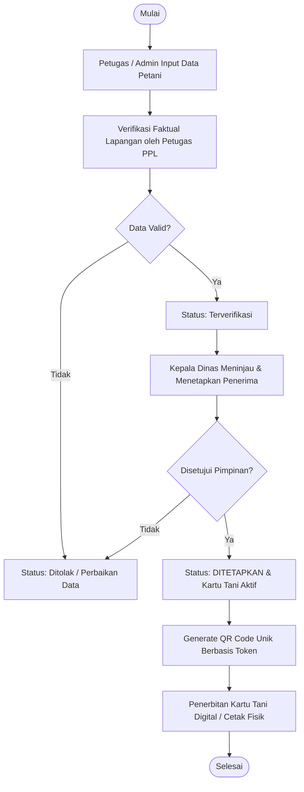
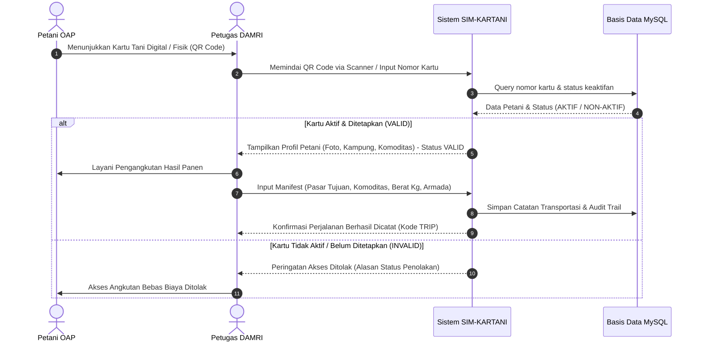

# Arsitektur Sistem SIM-KARTANI Biak Numfor

## 1. Gambaran Umum Sistem
**SIM-KARTANI BIAK NUMFOR** (Sistem Informasi Manajemen Kartu Tani OAP & Layanan Transportasi DAMRI) dirancang untuk menyelesaikan dua permasalahan fundamental pada **Dinas Pertanian dan Ketahanan Pangan Kabupaten Biak Numfor**, yaitu:
1. **Tata Kelola Pendataan Petani & Bantuan Otonomi Khusus (Otsus)**: Menggantikan pengelolaan berkas manual (Word & Excel) menjadi basis data terintegrasi berjenjang (Pendataan &rarr; Verifikasi Lapangan &rarr; Penetapan Kepala Dinas &rarr; Penerbitan Kartu Tani OAP).
2. **Akses Pemasaran Hasil Pangan & Integrasi Transportasi DAMRI**: Memfasilitasi petani Orang Asli Papua (OAP) membawa komoditas pascapanen (Keladi, Petatas, Kasbi, Sayuran) menuju pasar distribusi (Pasar Tani Fandoi, Pasar Darfuar, Pasar Bosnik) dengan validasi QR Code Kartu Tani digital secara realtime.

---

## 2. Aktor & Matriks Hak Akses (RBAC)

| Peran (Role) | Tanggung Jawab & Fitur Utama |
|---|---|
| **Admin Dinas** | Manajemen seluruh master data (petani, kelompok tani, distrik/kampung), manajemen pengguna, hak akses, audit log, dan ekspor laporan. |
| **Petugas Lapangan (PPL / Verifikator)** | Pendaftaran calon petani OAP, verifikasi faktual lapangan, upload catatan kondisi lahan, pencatatan penyaluran bantuan Otsus. |
| **Pimpinan (Kepala Dinas / Kabid)** | Menetapkan status penerima bantuan Otsus secara resmi (`DITETAPKAN` / `DITOLAK`), mengaktifkan Kartu Tani digital, monitoring executive dashboard & laporan. |
| **Petugas DAMRI (Operator / Driver)** | Pemindaian QR Code Kartu Tani di halte/titik kumpul, validasi keaktifan kartu, pencatatan manifest angkutan (asal, tujuan pasar, komoditas, berat dalam Kg, armada). |
| **Petani OAP (Penerima Manfaat)** | Mengakses portal petani digital mandiri, menampilkan Kartu Tani OAP & QR Code, mengecek riwayat bantuan yang diterima, dan riwayat perjalanan angkutan DAMRI. |

---

## 3. Alur Kerja Sistem (Workflow Architecture)

### A. Alur Administrasi & Penerbitan Kartu Tani

### B. Alur Penggunaan Kartu Tani untuk Transportasi DAMRI

---

## 4. Struktur Arsitektur Teknologi

- **Runtime**: Node.js v22 LTS (Express.js Framework)
- **Database**: MySQL Server (Database relational dengan ACID compliance & Foreign Key integrity)
- **View Engine**: EJS-compatible template engine dengan modular partials
- **Keamanan (Security)**:
  - Password hashing berbasis `scrypt` kriptografis dengan salt acak 128-bit
  - Sesi berbasis Cookie bertanda tangan (HMAC-SHA256 signature)
  - Proteksi XSS (Contextual HTML Escaping)
  - Proteksi IDOR & RBAC Middleware
  - Audit Trail Logging untuk setiap aksi kritis (Input, Verifikasi, Penetapan, Scan)
- **Library Integrasi**:
  - `qrcode`: Generator barcode QR 2D resolusi tinggi
  - `html5-qrcode`: Pemindai kamera QR real-time multi-platform (HP / Tablet / Laptop)
  - `Chart.js`: Visualisasi grafik sebaran distrik & komoditas
