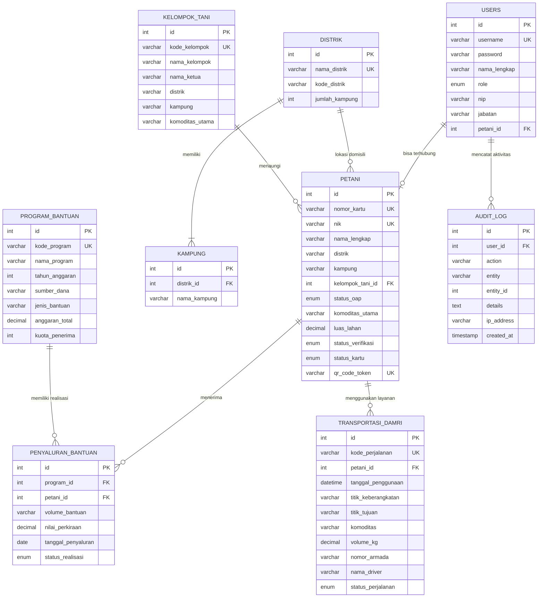

# Perancangan Basis Data (Database Design)

Basis data sistem menggunakan **MySQL** dengan nama `dinas_pertanian_db` dan character set `utf8mb4_unicode_ci`.

---

## 1. Entity Relationship Model (ERD)

---

## 2. Kamus Data (Data Dictionary)

### 1. Tabel `petani`
Menyimpan 500 data petani penerima bantuan OAP Kabupaten Biak Numfor:
- `id` (INT, Primary Key)
- `nomor_kartu` (VARCHAR(50), Unique, e.g. `KT-OAP-2026-0001`)
- `nik` (VARCHAR(25), Unique)
- `nama_lengkap` (VARCHAR(150))
- `tempat_lahir` (VARCHAR(100))
- `tanggal_lahir` (DATE)
- `jenis_kelamin` (ENUM('L', 'P'))
- `no_hp` (VARCHAR(25))
- `alamat` (TEXT)
- `distrik` (VARCHAR(100), Indexed)
- `kampung` (VARCHAR(100))
- `kelompok_tani_id` (INT, Foreign Key ke `kelompok_tani.id`)
- `status_oap` (ENUM('OAP', 'Non-OAP'))
- `komoditas_utama` (VARCHAR(100), e.g. 'Keladi Biak', 'Ubi Jalar')
- `luas_lahan` (DECIMAL(5,2), Satuan Hektar)
- `estimasi_panen_kg` (DECIMAL(8,2), Satuan Kg)
- `status_verifikasi` (ENUM('draft', 'diajukan', 'terverifikasi', 'ditetapkan', 'ditolak'))
- `status_kartu` (ENUM('aktif', 'nonaktif', 'ditangguhkan'))
- `verifikator_id` (INT, Foreign Key ke `users.id`)
- `tanggal_verifikasi` (DATETIME)
- `catatan_verifikasi` (TEXT)
- `penetap_id` (INT, Foreign Key ke `users.id`)
- `tanggal_penetapan` (DATETIME)
- `foto` (VARCHAR(255))
- `qr_code_token` (VARCHAR(100), Unique)

### 2. Tabel `transportasi_damri`
Menyimpan catatan pemanfaatan bus DAMRI untuk pengangkutan hasil panen:
- `id` (INT, Primary Key)
- `kode_perjalanan` (VARCHAR(50), Unique, e.g. `TRIP-202603-0001`)
- `petani_id` (INT, Foreign Key ke `petani.id`)
- `tanggal_penggunaan` (DATETIME)
- `titik_keberangkatan` (VARCHAR(150))
- `titik_tujuan` (VARCHAR(150), e.g. 'Pasar Tani Fandoi Biak')
- `rute` (VARCHAR(150))
- `komoditas` (VARCHAR(120))
- `volume_kg` (DECIMAL(8,2))
- `jumlah_kemasan` (INT)
- `jenis_kemasan` (VARCHAR(50))
- `nomor_armada` (VARCHAR(50))
- `nama_driver` (VARCHAR(100))
- `status_perjalanan` (ENUM('selesai', 'sedang_berjalan', 'dibatalkan'))
- `status_subsidi` (ENUM('gratis_otsus', 'berbayar'))
- `catatan_operasional` (TEXT)
